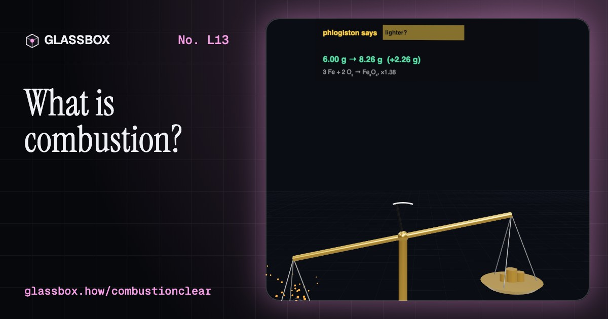
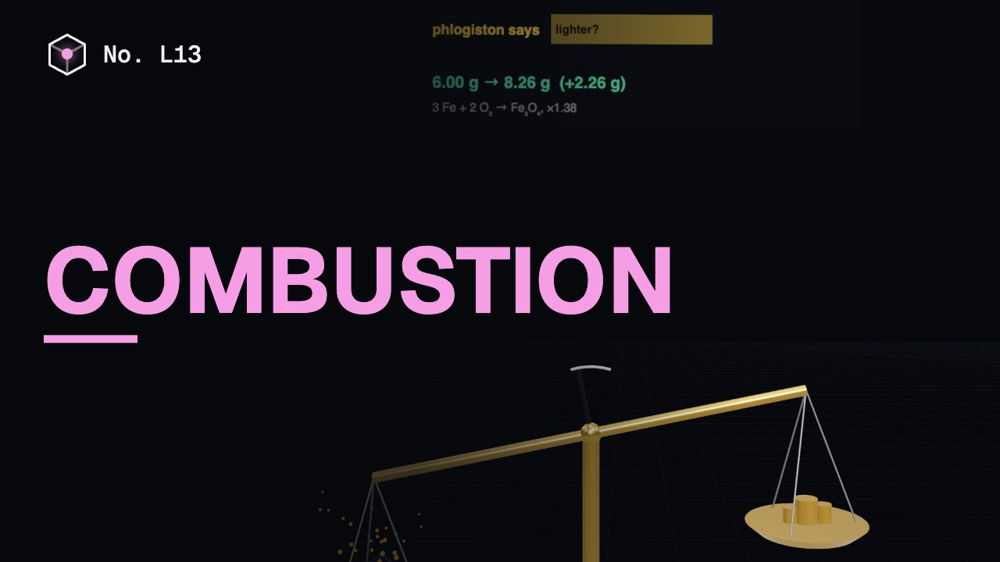
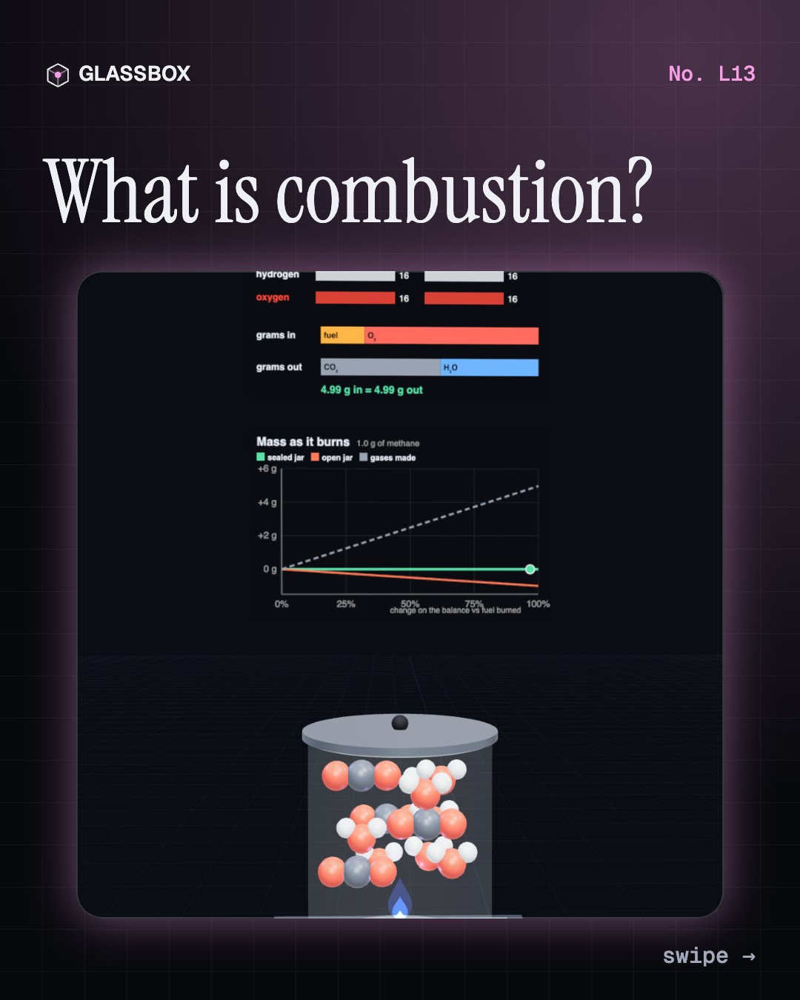
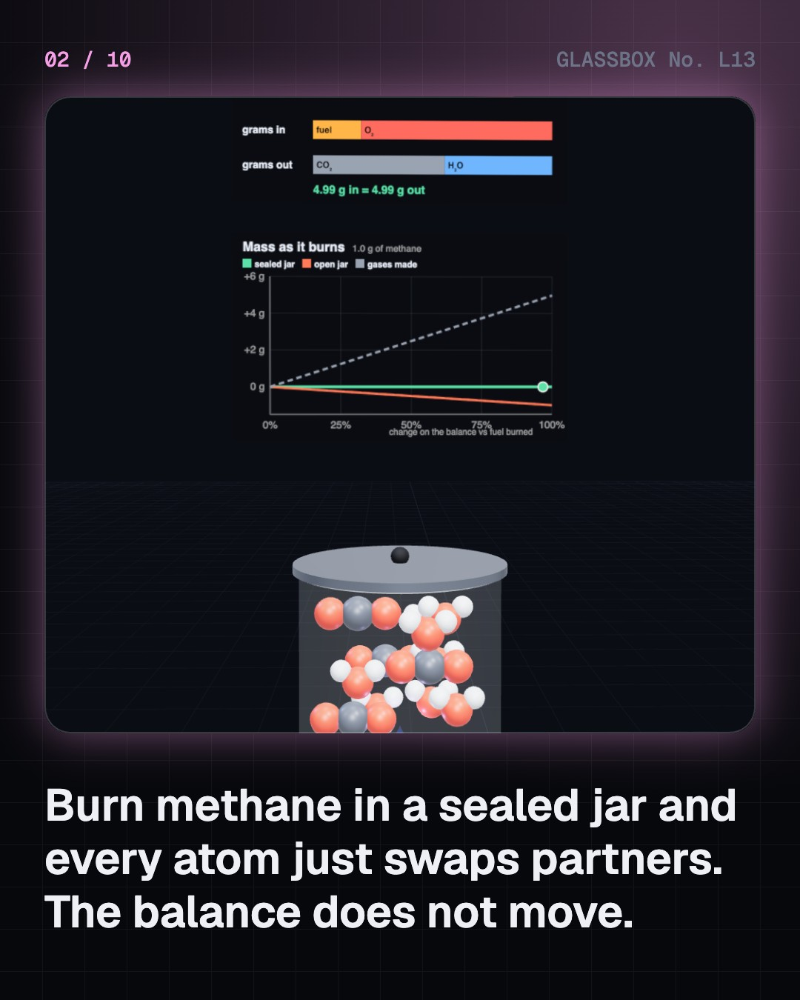
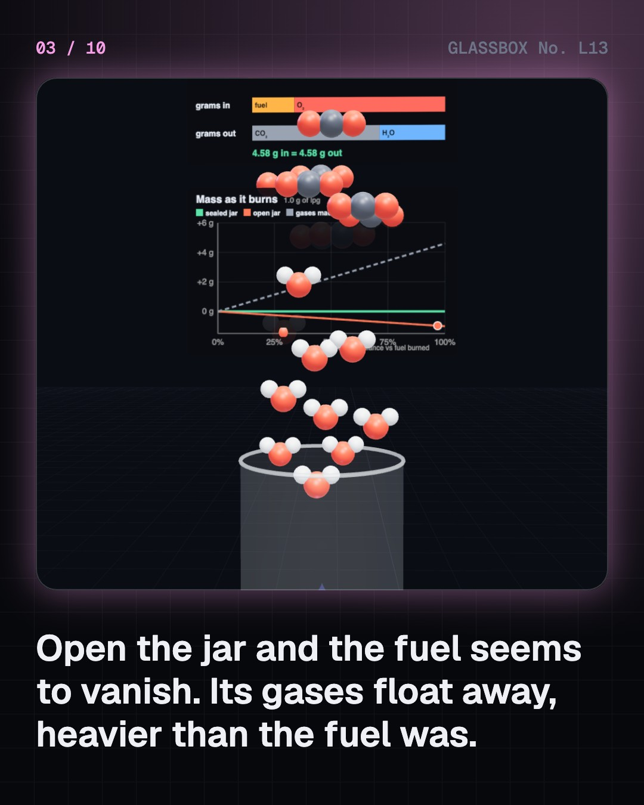
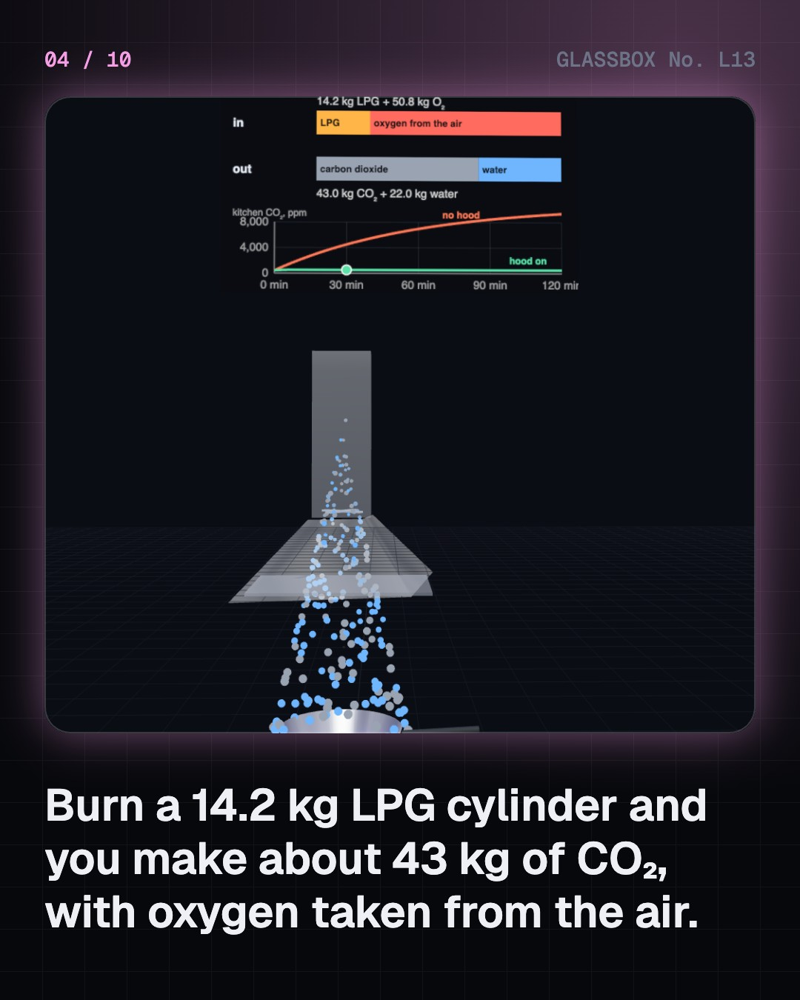

<!-- glassbox:start -->
<!-- Generated from glassbox.json by the Glassbox hub (npm run readme -- combustionclear). Edit glassbox.json, not this block. -->
<p align="center"><a href="https://glassbox-production-fd52.up.railway.app/e/combustionclear/"></a></p>

<h1 align="center">Combustion and conservation of mass</h1>

<p align="center"><b>What is combustion?</b><br>Burn a gas in a sealed jar on a balance and the reading doesn't budge: every atom is still there, just with new partners. Count them, weigh an LPG cylinder's 43 kg of CO₂, tune an engine's 14.7 : 1 mixture, put out a fire, and find out why lost fat leaves through your lungs.</p>

<p align="center"><a href="https://glassbox-production-fd52.up.railway.app/combustionclear/"><b>▶ Play with it</b></a> &nbsp;·&nbsp; <a href="https://glassbox-production-fd52.up.railway.app/e/combustionclear/">Read the 60-second explainer</a> &nbsp;·&nbsp; <a href="https://glassbox-production-fd52.up.railway.app/combustionclear/glassbox/reel.mp4">Watch the 40-second video</a></p>

<p align="center">
  <a href="https://glassbox-production-fd52.up.railway.app/e/combustionclear/"></a>
  <a href="https://glassbox-production-fd52.up.railway.app/e/combustionclear/"></a>
  <a href="LICENSE"></a>
  <a href="LICENSE-CONTENT.md"></a>
  <a href="#privacy"></a>
</p>

## In 60 seconds

1. **Burning swaps partners.** A fuel made of carbon and hydrogen joins with oxygen. Every carbon ends up in CO₂ and every hydrogen in H₂O: CH₄ + 2 O₂ → CO₂ + 2 H₂O. The atoms are the same on both sides, so the mass is too.
2. **Gases weigh more than the fuel.** The oxygen comes from the air, so the products outweigh the fuel. A 14.2 kg LPG cylinder makes about 43 kg of CO₂, and a litre of petrol, 0.74 kg, makes about 2.3 kg.
3. **Air decides how clean it burns.** Petrol needs 14.7 g of air per gram. With too little, carbon stops at carbon monoxide or soot: a yellow flame, a dirty exhaust, or a deadly room. A catalytic converter needs the mixture just right.
4. **Fire and your body.** Take away fuel, heat or oxygen and a fire goes out. Your cells run the same reaction slowly: about 84 % of the fat you lose is breathed out as CO₂.
5. **The limits.** A candle only seems to vanish, because it is an open system. E = mc² does take away about one part in 10 billion of the mass, far too little for any balance, so for chemistry mass is conserved.

## Words worth knowing

| Term | Meaning |
|---|---|
| **Combustion** | A fast reaction of a fuel with oxygen that gives out heat and light. |
| **Conservation of mass** | In a closed system, the total mass stays the same through any chemical reaction. |
| **Balanced equation** | A reaction written with the same number of each kind of atom on both sides. |
| **Closed and open systems** | A closed system lets no matter in or out; an open one, like a candle in a room, swaps matter with its surroundings. |
| **Air–fuel ratio** | Mass of air per mass of fuel. Petrol burns completely at 14.7 : 1. |
| **Incomplete combustion** | Burning with too little oxygen, which leaves carbon monoxide and soot. |
| **Heating value** | Heat from burning 1 kg of fuel: about 50 MJ for methane, 46 for LPG, 44 for petrol and 16 to 18 for dry wood. |
| **Fire triangle** | Fuel, heat and oxygen: a fire needs all three. |

## A short history

**From a million-year-old campfire to the Keeling Curve: how people learned that burning destroys nothing.**

- **1000000 BCE** · Ash deep inside a cave (Early humans, probably Homo erectus, Wonderwerk Cave, Northern Cape)
- **1703** · Phlogiston: fire as a substance (Georg Ernst Stahl, Halle)
- **1756** · Lomonosov's sealed flasks (Mikhail Lomonosov, St Petersburg)
- **1774** · Priestley's candle burns brighter (Joseph Priestley, Bowood House, Wiltshire)
- **1774** · Tin in a sealed retort (Antoine Lavoisier, Paris)
- **1789** · The law in a textbook (Antoine Lavoisier, with drawings by Marie-Anne Lavoisier, Paris)
- **1958** · Measuring the CO₂ we make (Charles David Keeling, Mauna Loa Observatory, Hawaii)

The full story, with 20 moments, charts, people and 29 sources: [glassbox.how/e/combustionclear/history](https://glassbox-production-fd52.up.railway.app/e/combustionclear/history/). The data lives in [`history.json`](history.json).

## Video and slides

Made with the Glassbox studio from this box's storyboard (`window.glassbox.director`). Free to reuse under CC BY 4.0.

<a href="https://glassbox-production-fd52.up.railway.app/combustionclear/glassbox/video.mp4"></a>

<p><a href="glassbox/slide-1.jpg"></a> <a href="glassbox/slide-2.jpg"></a> <a href="glassbox/slide-3.jpg"></a> <a href="glassbox/slide-4.jpg"></a></p>

| File | What | Size |
|---|---|---|
| [`glassbox/reel.mp4`](https://glassbox-production-fd52.up.railway.app/combustionclear/glassbox/reel.mp4) | Reel / Short, with captions and soundtrack | 1080×1920 |
| [`glassbox/video.mp4`](https://glassbox-production-fd52.up.railway.app/combustionclear/glassbox/video.mp4) | YouTube video, with captions and soundtrack | 1920×1080 |
| `glassbox/slide-1…10.jpg` | Instagram carousel | 1080×1350 |
| `glassbox/thumb.jpg` | YouTube thumbnail | 1280×720 |
| `glassbox/cover.jpg` | Share card and repo social preview | 1200×630 |
| [`glassbox/history-reel.mp4`](https://glassbox-production-fd52.up.railway.app/combustionclear/glassbox/history-reel.mp4) | “History in 10 moments” Reel / Short | 1080×1920 |
| `glassbox/history-slide-*.jpg` | History carousel | 1080×1350 |
| `glassbox/post.json` | Post copy and schedule used by the publish kit | |

## Privacy

This box has no accounts and no ads, and it ships its own fonts and libraries. When you run it yourself it sends nothing anywhere. On glassbox.how, the site's `/bar.js` also loads Glassbox's analytics: **Google Analytics** to count visits (it asks first in the EU, UK and Switzerland, and stays off when your browser sends Global Privacy Control or Do Not Track) and **ClickTrust** to detect bots.

It remembers a few things **in your own browser only**, and never sends them anywhere:

| Browser storage key | What it holds |
|---|---|
| `combustionclear.v1` | Which chapters you have opened, your best quiz scores, and sound on or off. |

Exactly what each one sees is at [glassbox.how/privacy](https://glassbox-production-fd52.up.railway.app/privacy/).

## Licences

- **Code:** [MIT](LICENSE). Use it, change it, ship it.
- **Explanations, text, images and videos** (`glassbox.json`, `glassbox/`): [CC BY 4.0](LICENSE-CONTENT.md). Credit “Glassbox, glassbox.how/e/combustionclear”.
- **Third-party parts** keep their own licences: [three.js](https://threejs.org) (MIT), [Geist, Instrument Serif](https://openfontlicense.org) (SIL OFL 1.1).
- The Glassbox name and logo aren't covered by either licence. See the [terms](https://glassbox-production-fd52.up.railway.app/terms/).

Found a mistake? [Open an issue](https://github.com/bdeeps/combustionclear/issues). Corrections happen in public.
<!-- glassbox:end -->

## Run it

It's plain HTML, CSS and JavaScript. No build step and no dependencies. Run locally, it contacts no other website.

```bash
python3 -m http.server 8000
```

Three.js and the fonts ship in `vendor/` and `fonts/`, so it also works offline.

Then open http://localhost:8000.

## How it's built

| File | What |
|---|---|
| `index.html`, `css/app.css` | The page and its styles |
| `js/app.js`, `js/stage.js`, `js/ui.js`, `js/kit.js` | The shared Glassbox 3D engine: chapters, 3D stage, controls, quiz, video director |
| `js/chapters/*.js` | One file per chapter: the 3D model, controls, text, key terms, quiz and video scenes |
| `js/combust.js` | Combustion chemistry (atomic masses, fuels and heating values, the oxygen-sharing burn model, balanced equations), atom-ball molecules that regroup, flames, a digital balance, chart boards and puffs, shared by the chapters |
| `glassbox.json` | Title, question, explainer beats, key terms, browser storage and credits shown on glassbox.how |
| `reel` in each chapter | The storyboard the Glassbox studio records into short videos |
| `glassbox/` | The published video, slides, thumbnail and post copy |
| `fonts/`, `vendor/three/` | Self-hosted Geist and Instrument Serif (SIL OFL 1.1) and three.js (MIT) |
